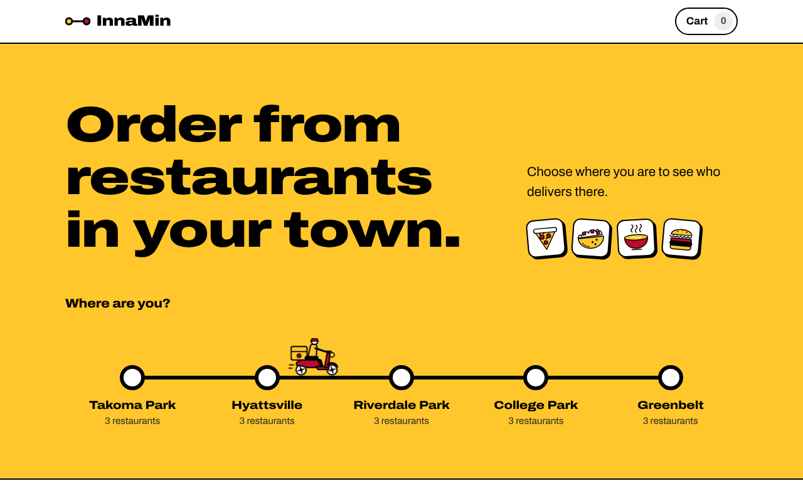
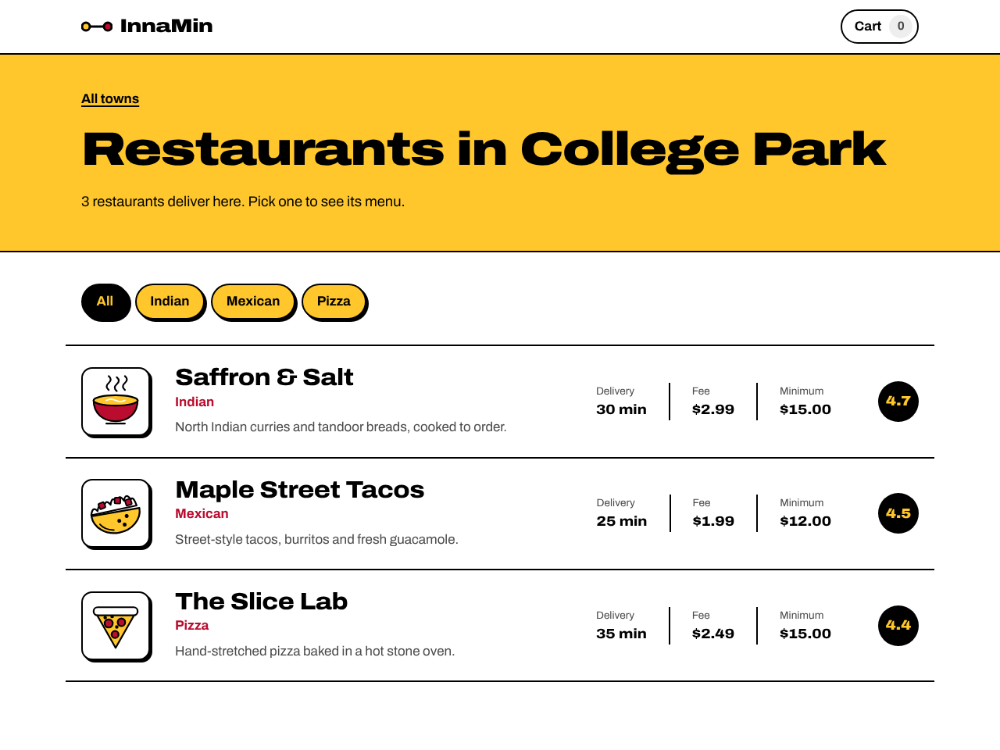
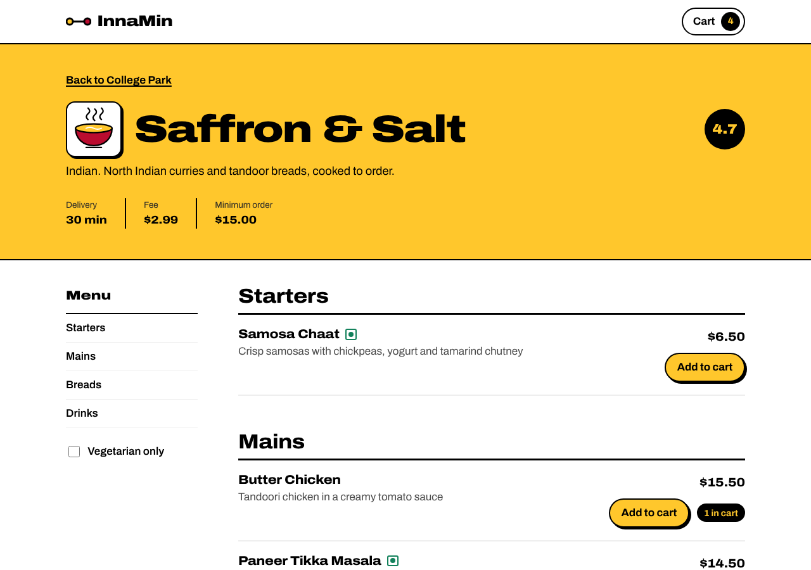
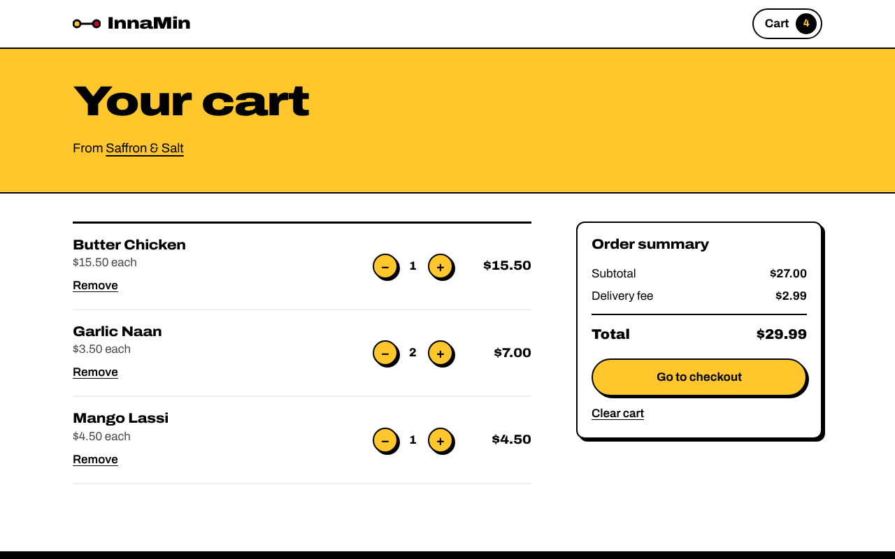
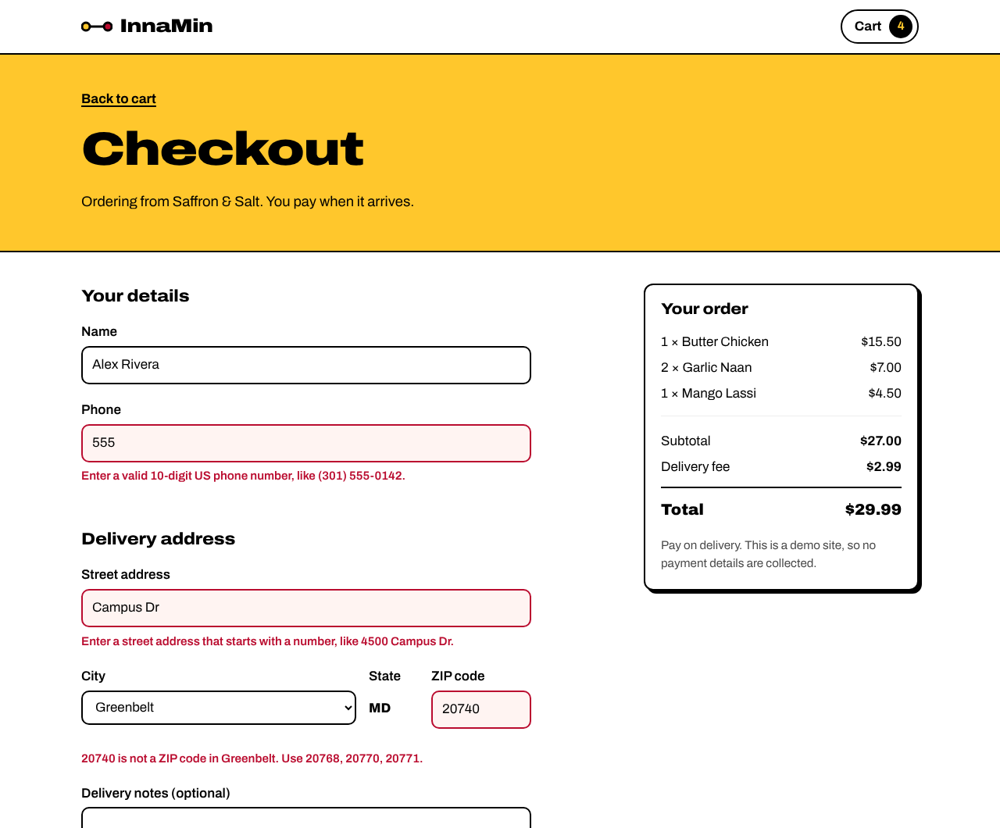
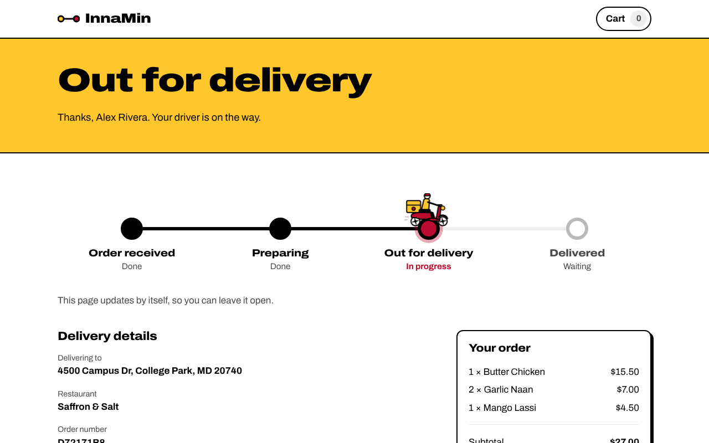
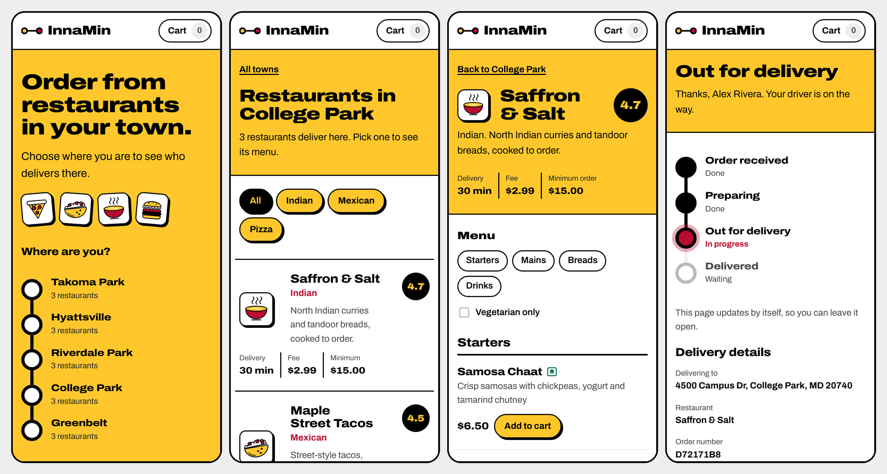

# InnaMin

A food-ordering website for the College Park area of Maryland. Pick your town, choose a restaurant, browse the menu, fill a cart, check out, and follow your order as it moves from the kitchen to your door.

InnaMin is a **practice project**. The restaurants, menus and orders are fictional, no payment is taken, and no food is delivered.



## Screenshots

<table>
  <tr>
    <td width="50%"><br><b>Restaurants in a town.</b> Filter by cuisine; every row has its own illustration.</td>
    <td width="50%"><br><b>The menu.</b> Sticky section list, vegetarian marker and a live "in cart" badge.</td>
  </tr>
  <tr>
    <td width="50%"><br><b>The cart.</b> Quantity steppers, per-dish totals and a summary that follows you down the page.</td>
    <td width="50%"><br><b>Checkout.</b> Errors appear under the field that caused them, such as a ZIP code that doesn't belong to the chosen city.</td>
  </tr>
</table>

### Following the order

The order page asks the server for an update every few seconds. The black line fills as the order moves along, the current stop pulses, and the scooter slides to the stop the order has reached.



### On a phone

Everything works on narrow screens. The route and the tracker turn into vertical lines.



## What it does

- **Choose a town.** Five service areas near College Park, laid out on a route-map line in rough map order: Takoma Park, Hyattsville, Riverdale Park, College Park and Greenbelt.
- **Browse restaurants.** Each town lists its restaurants with cuisine, delivery time, fee, minimum order and rating, and a cuisine filter.
- **Read the menu.** Dishes are grouped by category with a sticky section menu and a vegetarian-only toggle.
- **Build a cart.** Add, remove and change quantities. The cart survives a page refresh. Switching restaurants asks before it empties your cart.
- **Check out.** A real form with validation on both the browser and the server (rules below).
- **Track the order.** The order page polls the server every 5 seconds and moves through *Order received, Preparing, Out for delivery, Delivered*, with a scooter that rides along the tracker line.

## Tech stack

| Part | Technology |
| --- | --- |
| Front end | React 19, Vite, React Router |
| Back end | ASP.NET Core minimal API on .NET 10 |
| Database | SQLite through Entity Framework Core, with migrations |
| Styling | Plain CSS with custom properties, self-hosted Archivo variable font |

## Running it locally

You need the [.NET 10 SDK](https://dotnet.microsoft.com/download) and [Node.js](https://nodejs.org) 20.19 or newer.

The API and the website run as two separate programs, so use two terminal windows.

**1. The API**

```bash
cd InnaMin.Api
dotnet run
```

The API listens on `http://localhost:5184`. On the first run it creates the SQLite database file (`innamin.db`), applies the migrations and loads the sample data: 5 towns, 15 restaurants and 90 dishes. Delete `innamin.db` any time to start fresh.

**2. The website**

```bash
cd innamin-web
npm install
npm run dev
```

Open `http://localhost:5173`.

The API address is set in `innamin-web/src/api.js`, and the API only accepts requests from the Vite dev server's address, so if you change a port, change it in both places.

## API

| Method | Route | What it returns |
| --- | --- | --- |
| GET | `/areas` | All service areas with their restaurant counts |
| GET | `/areas/{id}/restaurants` | One area and the restaurants that deliver there |
| GET | `/restaurants/{id}` | A restaurant with its full menu |
| POST | `/orders` | Places an order. Returns the new order id, or field-by-field validation errors |
| GET | `/orders/{id}` | An order, with its current `status` and `elapsedSeconds` |

Some choices worth knowing about:

- **The server is the authority on money.** The browser sends dish ids and quantities, never prices. The server looks up the prices and works out the subtotal, delivery fee and total itself.
- **Order ids are GUIDs**, so one customer can't guess another customer's order number.
- **Order status is calculated from time**, not stored. The server compares the order's `PlacedAt` with the current time:

  | Time since placed | Status |
  | --- | --- |
  | under 30 seconds | received |
  | under 2 minutes | preparing |
  | under 4 minutes | out for delivery |
  | after that | delivered |

  The timings are short on purpose so the whole journey can be watched in a demo.

## Validation

The same rules run in the browser (for quick feedback) and on the server (because the browser can't be trusted). The server returns errors keyed by field name, and the form puts each message under the right input.

- **Phone:** a US number, 10 digits once spaces, dashes and brackets are removed, with an optional leading `1`. Area code and exchange can't start with 0 or 1.
- **Street:** starts with a house number and contains a real street name.
- **City:** chosen from the five service areas.
- **ZIP:** five digits that actually belong to the chosen city (for example, 20740 is accepted for College Park but not for Greenbelt).
- **Minimum order:** each restaurant has one, and checkout is blocked below it.

## Design

- **Colours:** the four colours of the Maryland flag, black, gold, red and white, with grey for secondary text. The only other colour is a green marker on vegetarian dishes. Text colours were checked for contrast, and the bright red from the original design was replaced because it failed on white.
- **Idea:** the site is a transit map. Towns are stops on a line, and the order tracker reuses the same line, so the home page and the tracker feel like one system.
- **Type:** Archivo, with wide letterforms for headings.
- **Buttons:** sticker-style pills with a hard black shadow that presses down when clicked.
- **Illustrations:** drawn as SVG in code, with no stock images. There is one picture per kind of food, chosen from the restaurant's cuisine, plus the delivery scooter.
- **Motion:** the route line draws itself, stops pop in, the scooter drives and its wheels spin, and the tracker fills as the order progresses. Everything that loops forever is turned off for people who have asked their device for reduced motion.
- **Accessibility:** a skip-to-content link, visible keyboard focus, form errors announced to screen readers, status shown in words as well as colour, and decorative graphics hidden from assistive technology.

## Project layout

```
innamin/
├── InnaMin.Api/              ASP.NET Core API
│   ├── Program.cs            Endpoints
│   ├── OrderValidation.cs    Phone, address, city and ZIP rules
│   ├── OrderStatus.cs        Time-based order status
│   ├── Models/               Area, Restaurant, MenuItem, Order, OrderItem, request types
│   ├── Data/                 AppDbContext and the sample-data seeder
│   └── Migrations/           EF Core database migrations
├── docs/                     Screenshots used in this README
└── innamin-web/              React front end
    ├── index.html
    ├── public/               Favicon
    └── src/
        ├── main.jsx          Entry point
        ├── App.jsx           Layout, header, routes, footer
        ├── api.js            API address and a small POST helper
        ├── useApi.js         Hook for loading data
        ├── CartContext.js    Cart context
        ├── CartProvider.jsx  Cart state, saved to localStorage
        ├── CuisineArt.jsx    Food illustrations
        ├── Scooter.jsx       Delivery scooter
        ├── format.js         Money formatting
        ├── index.css         All styles
        └── pages/
            ├── HomePage.jsx
            ├── AreaPage.jsx
            ├── RestaurantPage.jsx
            ├── CartPage.jsx
            ├── CheckoutPage.jsx
            └── OrderPage.jsx
```

Money is handled in whole cents inside the cart and checkout code, which avoids the rounding errors you get from adding decimal prices.

## Roadmap

- Loading skeletons and gentle page transitions
- A proper confirmation dialog in place of the browser's built-in one
- Move the API address into an environment variable so the site can be deployed
- Deploy the API and the front end

## About

Built by Monish Vijay Bharat as a learning project, step by step, to practise full-stack development with React, ASP.NET Core and SQLite.
